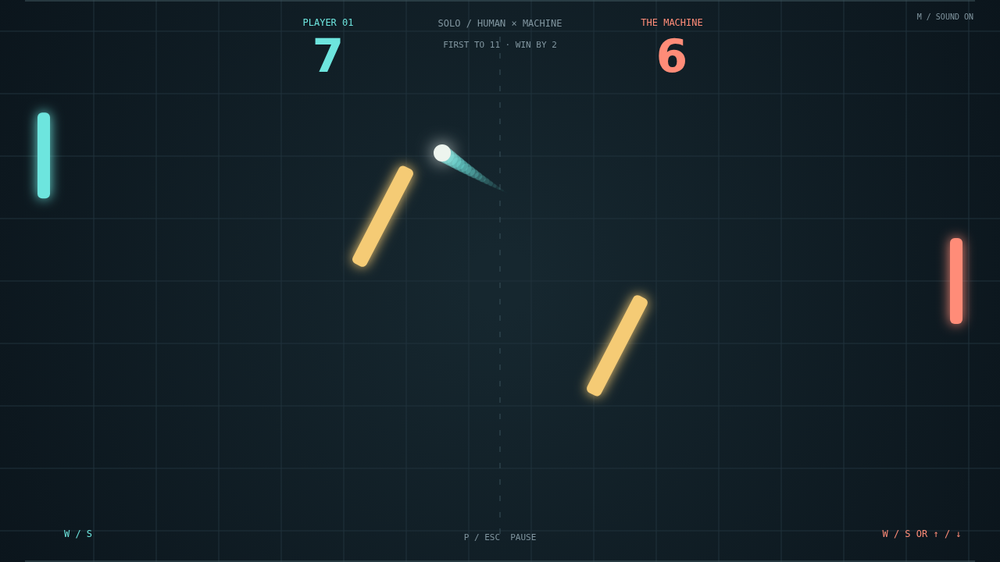

# Carom

Two paddles. One ball. A field full of possibilities. Carom is a fast paddle duel where a clean return can become a curving shot, and the shortest route across the court is rarely the most interesting one.

Your paddle's motion puts spin on every hit. Meet the ball while sliding down to bend its flight clockwise; sweep upward to turn it the other way. Aim with the edge of your paddle, then watch the trail sketch your shot across the dark court.

Two gold obstacles sway and turn between you and your opponent. A rally can ricochet into a surprising bank shot, giving you a new opening just when the other paddle seems to have everything covered. Each return picks up speed, so every exchange asks for a little more nerve.

Challenge the machine in Solo or take opposite sides of a shared keyboard in Versus. The first serve gives you a moment to get ready; match point demands a two-point lead. At ten-all, there is still another angle to find.

